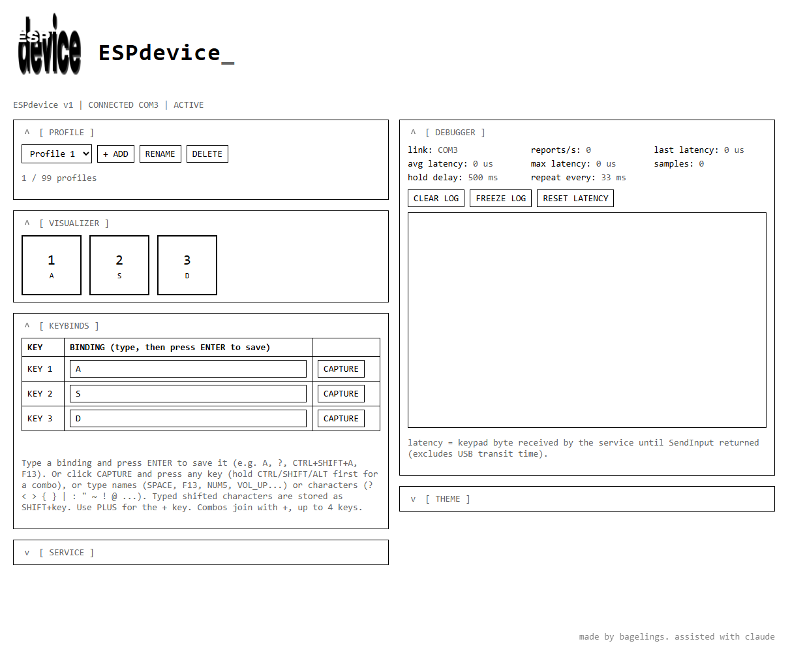
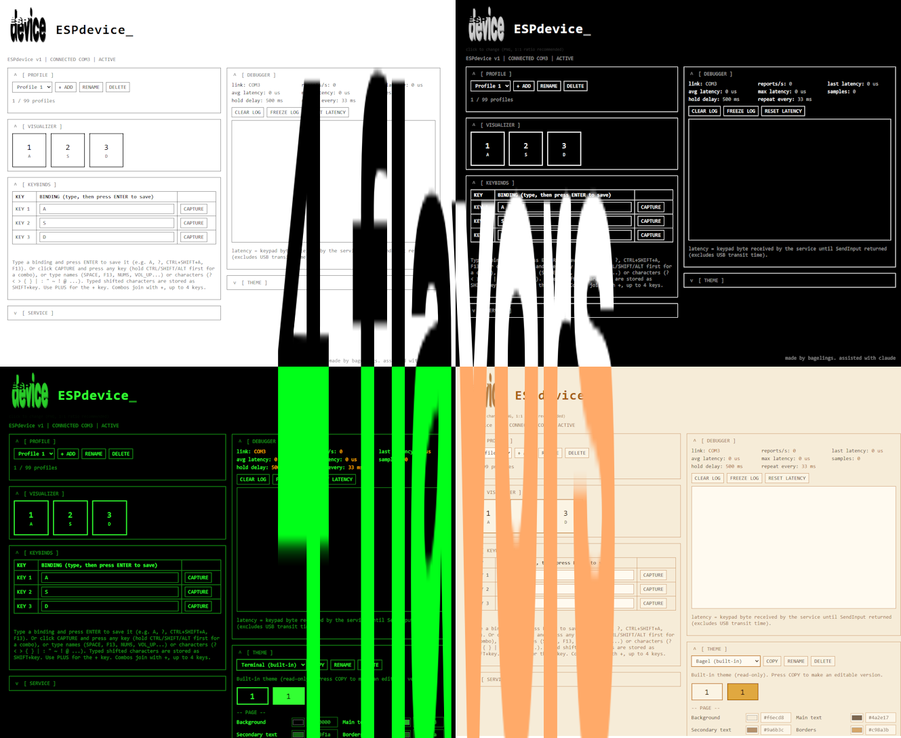

# ESPdevice

(This entire project is made with Claude Code, all image assets (such as the logo) is made by bagelings)





Turn a cheap ESP32 and a few switches into a 3-key USB keypad for Windows. A small background app listens to the ESP32 over serial and types real keystrokes, with profiles, a live key visualizer, a latency debugger and themes, all in a local web page.

Good for gaming (bind keys to whatever your game uses, one profile per game), but it works for anything: macros, media keys, shortcuts.

```
 [ switch ]--GPIO4--+
 [ switch ]--GPIO5--+--[ ESP32 ]==USB==[ PC: ESPdevice.exe ]--> keystrokes in any app or game
 [ switch ]--GPIO13-+                          |
                                      http://localhost:9191  (settings, visualizer, debugger)
```

> **Supported hardware (so far):** classic ESP32 dev boards (e.g. ESP32 WROOM-32) that show up in Windows as a **serial / COM port** through a USB-to-serial chip (CP2102, CH340, etc.). The keypad talks plain serial. There is no Bluetooth, WiFi or native-USB-HID mode yet, so boards that don't expose a COM port are not supported.

## Download

Get the latest build from the [**Releases**](../../releases/latest) page. No Visual Studio needed.

- `ESPdevice-win-installer.zip` contains the installer, `ESPdevice-Setup.exe` (per-user, no admin prompt). Unzip it, then run it. It can also start ESPdevice when you sign in to Windows.
- `ESPdevice-win-portable.zip` is just `ESPdevice.exe` (plus the license). Keep it in a folder you can write to, because it saves your `config\` folder next to itself.

> **Unsigned app:** ESPdevice isn't code-signed (certificates cost money), so Windows
> SmartScreen may show "Windows protected your PC" the first time you run the installer
> or `ESPdevice.exe`. Click **More info**, then **Run anyway**. The full source is in
> this repo and the release files are built by GitHub Actions from it
> (see `.github/workflows/build.yml`), so you can check or build it yourself.

You still need to build and flash the keypad itself, see [Make your own keypad](#make-your-own-keypad).

## Contents
- [Download](#download)
- [Features](#features)
- [Using it as a gaming keypad](#using-it-as-a-gaming-keypad)
- [Make your own keypad](#make-your-own-keypad)
  - [1. Wire it](#1-wire-it)
  - [2. Flash the ESP32 with the Arduino IDE](#2-flash-the-esp32-with-the-arduino-ide)
  - [3. Install the Windows app](#3-install-the-windows-app)
  - [4. Make it start with Windows (portable zip only, optional)](#4-make-it-start-with-windows-portable-zip-only-optional)
- [Using the settings page](#using-the-settings-page)
- [Troubleshooting](#troubleshooting)
- [Limitations](#limitations)
- [How it works (serial protocol)](#how-it-works-serial-protocol)
- [Repo layout](#repo-layout)
- [License](#license)

## Features

**Input**
- Keyboard-style input: sends real scan codes with `SendInput`, with tap and hold.
- Typematic repeat: holding a key repeats using your own Windows keyboard delay and repeat rate.
- Bind any key to a single key, a combo of up to 4 keys (e.g. `CTRL+SHIFT+A`) or a media key.
- Everything is bindable: letters, digits, symbols, F1-F24, numpad, left/right modifiers, arrows and navigation keys, media keys (play/next/prev/stop, volume), browser and launch keys.
- Type a binding and press ENTER to save it, or click CAPTURE and press the key (hold CTRL/SHIFT/ALT first for a combo).
- Shifted characters are stored as the physical key (on a US layout), e.g. `?` becomes `SHIFT+SLASH`. Use `PLUS` for the `+` key.
- Safety nets: a stuck key is force-released if the board goes silent for 1.5 s, and held keys are released when you pause, unplug the board or quit.

**Speed**
- One dedicated high-priority thread blocks on the serial port and wakes the instant a byte arrives. The key path takes no locks and touches no files or network: byte, array lookup, `SendInput`.
- 921600 baud, 5 ms debounce on the board.
- Opts out of Windows 11 background power throttling and uses 1 ms timer resolution so repeat timing stays accurate.

**Profiles**
- Up to 99 profiles, each with its own 3 bindings. Add, rename, delete and switch from the page.
- Saved atomically to `config\profiles.json`, so a crash mid-save can't corrupt it.

**Visualizer and debugger**
- Live key visualizer: presses are pushed to the page instantly (Server-Sent Events, no polling).
- Debugger: link status and COM port, reports per second, event log (freeze/clear), your Windows hold delay and repeat rate, and measured latency (last / average / max) from byte received to `SendInput` returned.

**Windows (new in 1.1)**
- Every section (PROFILE, VISUALIZER, KEYBINDS, SERVICE, DEBUGGER, THEME, SETTINGS) is a floating window. Drag it by the title bar to put it anywhere, with nothing snapping. Each window has a resize handle in both bottom corners and shows its own icon at the right end of the title bar (if you made one, see [ICONS.md](ICONS.md)).
- The first time (or after RESET WINDOW LAYOUT) the windows are arranged like in 1.0: two columns in the middle of the page, PROFILE, VISUALIZER, KEYBINDS and SERVICE on the left and DEBUGGER on the right. THEME and SETTINGS start closed.
- Resize a window by dragging the small corner mark at its bottom-left or bottom-right.
- Click the `v` button to minimize a window into a small icon window. It appears where the window was and can be dragged and resized too. `^` (or a double-click) opens the window again, right where the icon window is now.
- Snapping windows to zones is planned for a future build.
- Everything is remembered exactly: position, size, minimized state, icon window position and size and stacking order, saved in `config\layout.json`. **SETTINGS > RESET WINDOW LAYOUT** puts everything back.
- Icons: put 256x256 PNG files in `config\icons\` named `Profile_icon.png`, `Visualizer_icon.png`, `Keybinds_icon.png`, `Service_icon.png`, `Debugger_icon.png`, `Theme_icon.png` and `Settings_icon.png` (transparent background). They are used for the minimized window, the title bar and the top-right buttons. Without them a placeholder or text is shown. Full list in [ICONS.md](ICONS.md).

**Settings and extras**
- A thin line across the page (50% opacity) separates the windows from the links and status strip. Windows can still be dragged below it.
- The VISUALIZER shows **CPS** (key presses in the last second, all keys) and **Total** (every press since the counter started). The app counts the total itself, so presses are counted even with the page closed; it is saved in `config\counters.json`. Reset both in SETTINGS.
- The settings and themes buttons and the social links become your own icons when `Settings_icon.png`, `Theme_icon.png`, `Github_icon.png` and so on exist in `config\icons\`; otherwise text is shown.
- The `[ THEMES ]` button at the top right opens and closes the THEME window. The `[ SETTINGS ]` button next to it opens the settings window (saved in `config\settings.json`): keeping both buttons on top of the windows, resetting the counters, resetting the window layout, and which social links to show.
- Social links (GitHub, YouTube, TikTok, Discord) sit in the bottom-left corner and can be switched off one by one.
- The connection status (for example `CONNECTED COM3 | ACTIVE`) and the credit with the version number sit in the bottom-right corner.

**Themes and look**
- Themes: Light (default), Dark, Terminal and Bagel, plus your own. COPY a theme and edit about 36 individual colors with live preview; saved to `config\theme.json`.
- The default logo is recolored automatically to match the active theme (custom themes too).
- Click the logo to use your own PNG (max 1 MB, 1024x1024 px; square recommended). Or drop a PNG at `config\default_logo.png` to change the built-in default. `[reset]` goes back to default.
- Optional plain-text title art in `config\art.txt`, shown only when there is no logo image.

**Service**
- Tray icon: Open Settings, Pause/Resume, Terminate. Double-click it to open the settings page.
- Finds the keypad by itself: it queries each COM port and picks the one that answers, so no fixed port number. It reconnects when you replug the board.
- Only one copy can run at a time (a second launch just opens the settings page).
- Logs to `config\espdevice.log`, including a `FATAL:` line if it ever hard-crashes.
- Safe by design: the web page only listens on `localhost`, rejects wrong `Host` headers (DNS rebinding), and needs a custom header for any change, so other websites can't remap your keys.

## Using it as a gaming keypad

1. Build the keypad and the app (see below) and run `ESPdevice.exe`. The page at http://localhost:9191 should say `CONNECTED COMx`.
2. Create a profile per game: **PROFILE** > `+ ADD`, then name it after the game.
3. Under **KEYBINDS**, bind each of the 3 keys to what the game expects. Type it (`SPACE`, `F`, `CTRL+E`...) or use CAPTURE and press the key. Only keyboard and media keys are supported, not mouse buttons.
4. Switch profiles from the dropdown before launching a game. The keys change instantly.
5. Press a key and watch the **VISUALIZER** light up to confirm the binding. The **DEBUGGER** shows the input latency.

Tips:
- **Games running as administrator:** Windows won't let a normal program send input to an elevated window. If the keys work on the desktop but not in the game, run `ESPdevice.exe` as administrator too.
- **Anti-cheat:** some games block software-generated input. ESPdevice sends standard `SendInput` scan codes, which most games accept, but it can't get past a game that rejects injected input.
- Use **PAUSE** (page or tray) when you don't want the pad typing, for example during a chat. Held keys are released immediately.
- Holding a key repeats it like a normal keyboard, using your Windows repeat settings.

## Make your own keypad

You need:
- An ESP32 dev board that appears as a COM port (e.g. ESP32 WROOM-32 with a CP2102 or CH340 USB chip)
- 3 momentary switches or buttons (mechanical keyboard switches work great)
- Wire, and a **data-capable** USB cable (charge-only cables won't work)
- A Windows PC

### 1. Wire it

Connect one side of each switch to a GPIO pin and the other side to **GND**. No resistors are needed because the firmware uses the ESP32's internal pull-ups.

| Key | GPIO | Other side of the switch |
|-----|------|--------------------------|
| 1   | GPIO 4  | GND |
| 2   | GPIO 5  | GND |
| 3   | GPIO 13 | GND |

(GPIO numbers are usually labelled `D4`, `D5`, `D13` on dev boards.)

To change the pins or the order, edit `KEY_PINS` at the top of the sketch. The order of the numbers decides which key is key 1, 2 and 3 on the PC. If the keys light up in the wrong order in the visualizer, swap the numbers in the sketch rather than the wiring.

### 2. Flash the ESP32 with the Arduino IDE

1. Install the **Arduino IDE** (2.x) from https://www.arduino.cc/en/software.
2. Add ESP32 support: **File > Preferences**, and in *Additional boards manager URLs* add:
   `https://espressif.github.io/arduino-esp32/package_esp32_index.json`
3. Open **Tools > Board > Boards Manager**, search for **esp32** and install **"esp32 by Espressif Systems"**.
4. Plug in the ESP32. If no new COM port appears under **Tools > Port**, install the driver for your board's USB chip (CP210x from Silicon Labs, or CH340).
5. Open `firmware/ESPdevice/ESPdevice.ino` in the Arduino IDE.
6. Select **Tools > Board > esp32 > ESP32 Dev Module** and choose your COM port under **Tools > Port**.
7. Click **Upload**. If it hangs on `Connecting......`, hold the board's **BOOT** button until the upload starts.
8. **Close the Serial Monitor** afterwards. Only one program can use the COM port at a time, so an open Serial Monitor (or Arduino upload in progress) will stop ESPdevice from connecting.

The firmware only sends serial bytes: no WiFi, no Bluetooth, nothing else, which keeps the loop fast.

### 3. Install the Windows app

1. Download `ESPdevice-win-installer.zip` from the [Releases](../../releases/latest) page, unzip it and run `ESPdevice-Setup.exe`. It installs to `%LocalAppData%\ESPdevice`.
2. Close any older copy first, because two copies would both type every key.
3. Tick **Start ESPdevice when I sign in to Windows** if you want it to launch quietly at log-in (then you can skip step 4), and finish the installer.
4. A tray icon appears. Right-click it and choose **Open Settings**, or browse to http://localhost:9191.

Prefer no installer? Unzip `ESPdevice-win-portable.zip` somewhere permanent (for example `C:\ESPdevice\`) and run `ESPdevice.exe`.

<details>
<summary>Build it yourself instead</summary>

You need the C++ compiler from Visual Studio (the free **Build Tools for Visual Studio** with the *Desktop development with C++* workload is enough).

1. Open the **Developer Command Prompt for VS** and go to the `app` folder. Keep all four files together: `ESPdevice.cpp`, `default_logo.h`, `espdevice.rc` and `espdevice.ico`.
2. Run:

```
rc /nologo espdevice.rc
cl /EHsc /std:c++17 /O2 /MT /DUNICODE /D_UNICODE ESPdevice.cpp espdevice.res /link /SUBSYSTEM:WINDOWS /OUT:ESPdevice.exe
```

3. Move `ESPdevice.exe` to a permanent folder. It creates a `config\` folder next to itself for your profiles, theme and log.

GitHub Actions builds the installer the same way on every push (see `.github/workflows/build.yml` and `installer/ESPdevice.iss`).

</details>

### 4. Make it start with Windows (portable zip only, optional)

If you used the installer you can skip this: just tick the start-with-Windows box in the installer.

1. In the folder with `ESPdevice.exe`, right-click it and choose **Create shortcut** (on Windows 11: **Show more options > Create shortcut**).
2. Press **Win + R**, type `shell:startup` and press Enter. The Startup folder opens.
3. Copy the shortcut you just made and paste it into the Startup folder.

ESPdevice now launches quietly into the tray every time you log in. To stop it starting, delete the shortcut from the Startup folder.

## Using the settings page

Open http://localhost:9191 (or tray icon > Open Settings).

| Section | What it does |
|---------|--------------|
| **SETTINGS** | Opened with the button at the top right: buttons on top, social links, reset counters, reset window layout. |
| **PROFILE** | Pick, add, rename or delete profiles (up to 99). |
| **VISUALIZER** | Shows the 3 keys lighting up live, with their current bindings. |
| **KEYBINDS** | Edit each key's binding: type + ENTER, or CAPTURE. |
| **SERVICE** | PAUSE / RESUME typing, or TERMINATE the app. |
| **DEBUGGER** | Link status, reports per second, latency stats, live event log. |
| **THEME** | Opened with the `[ THEMES ]` button at the top right. Switch, copy, rename, delete and edit color themes. |

## Troubleshooting

- **`NO KEYPAD` on the page:** check you're using a data USB cable, that the board's driver is installed, and that nothing else (Arduino Serial Monitor, another terminal program) has the COM port open. Terminate ESPdevice before uploading new firmware for the same reason.
- **Keys are in the wrong order:** swap the numbers in `KEY_PINS` in the sketch and re-upload.
- **Keys work on the desktop but not in a game:** run `ESPdevice.exe` as administrator, or the game may be blocking injected input.
- **Every key types twice:** two copies are running. Terminate the extra one from the tray.
- **Page won't open:** another program may be using port 9191. Check `config\espdevice.log`.
- **Anything else:** look in `config\espdevice.log` for `FATAL:` or `ERROR in` lines.

## Limitations

- Windows only.
- Exactly 3 keys at the moment.
- Classic ESP32 boards that show up as a serial/COM port only (see above).
- Key names assume a US keyboard layout.
- Keyboard and media keys only, no mouse buttons.

## How it works (serial protocol)

The board sends one byte per key event at 921600 baud, so you can write your own firmware for any board that can talk serial:

| Event | Byte |
|-------|------|
| key N pressed | `N*2 - 1` (key 1 = `0x01`, key 2 = `0x03`, key 3 = `0x05`) |
| key N released | `N*2` (key 1 = `0x02`, key 2 = `0x04`, key 3 = `0x06`) |
| key N held | the press byte repeats every 20 ms (a keepalive, so the PC can tell "still held" from "board unplugged") |
| identity query | PC sends `0xFE`, board replies `3KEY\n`. This is how the app finds the right COM port. |

## Repo layout

```
firmware/ESPdevice/ESPdevice.ino   Arduino sketch for the ESP32
app/ESPdevice.cpp                  The Windows app (one file; includes the website)
app/default_logo.h                 Built-in logo, embedded as bytes
app/version.h                      The version number shown on the page (the release build writes it from the git tag)
app/espdevice.rc, espdevice.ico    Tray/exe icon
installer/ESPdevice.iss            Inno Setup script for ESPdevice-Setup.exe
.github/workflows/build.yml        Builds the exe, installer and portable zip; attaches them to releases
```

To publish a new version: push a tag like `v1.1.1`. GitHub Actions writes the version number into `app/version.h`, builds everything and attaches it to a Release.

## License

The code is licensed under the [GNU GPL v3.0](LICENSE). The logo and icon artwork are made by bagelings and are all rights reserved.
